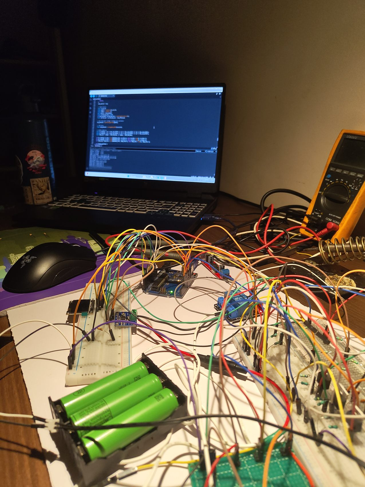
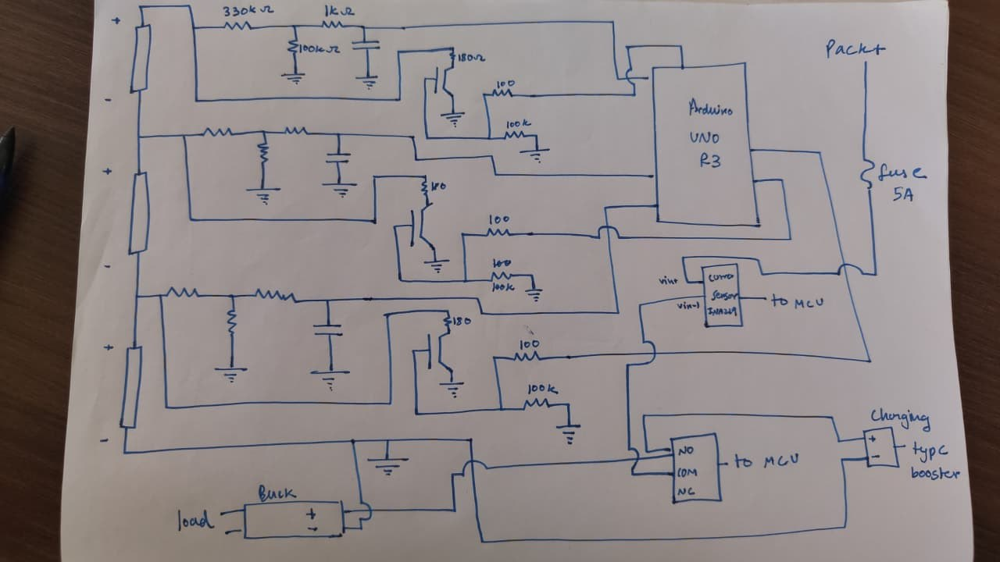
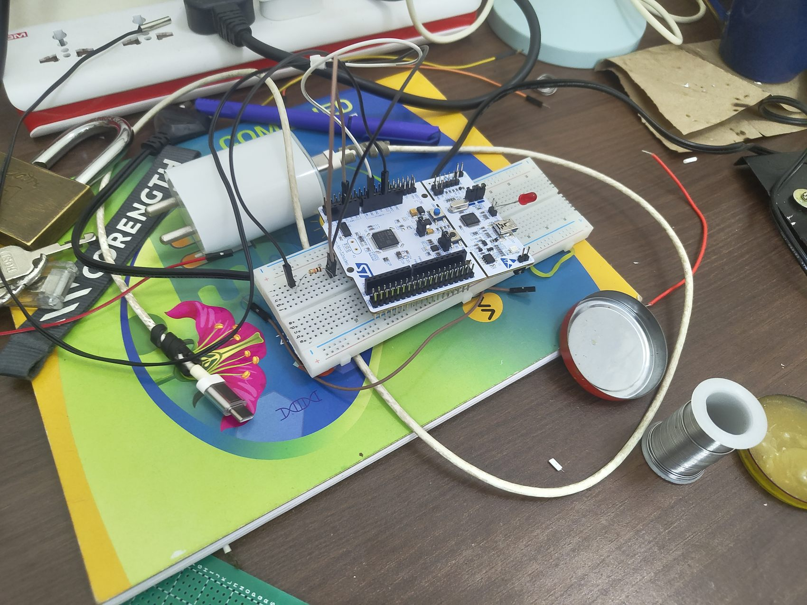
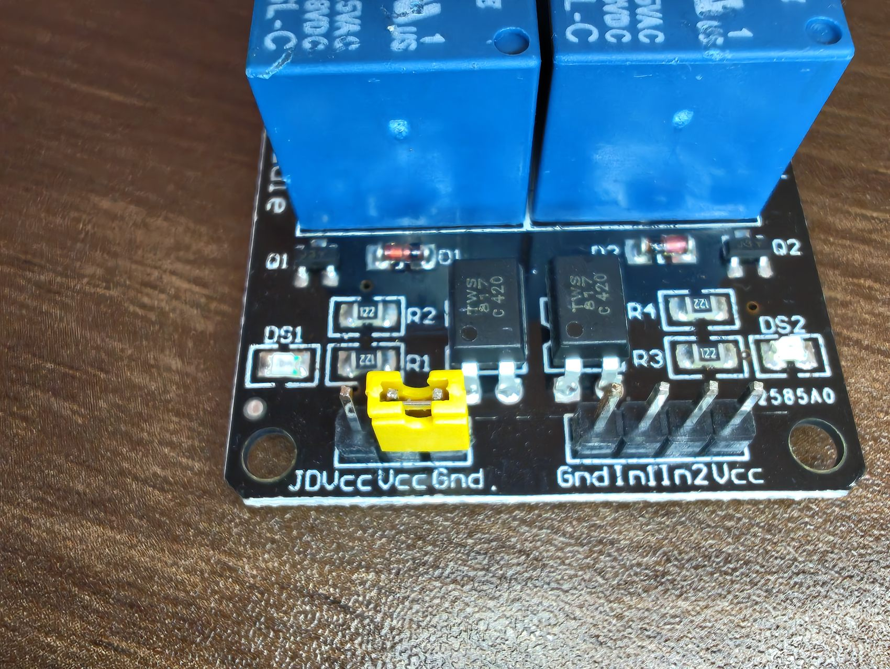

# 3S Battery Management System (Arduino Prototype)

**Arduino-based experimental battery-monitoring and protection prototype for a three-cell (3S) lithium-ion pack.** This project demonstrates individual cell-voltage measurements, temperature sensing, optional current sensing, relay-based disconnect control, and control signals for passive cell balancing.



> **Safety note:** This is an educational/experimental prototype, **not a certified BMS** or a substitute for independently verified battery-protection hardware. The original firmware has known limitations (including a relay-on startup sequence). **Do not rely on it as the sole protection for charging or operating a lithium-ion pack.** See [Known limitations](docs/technical-notes.md#known-limitations-and-safety-review).

## Overview

The firmware samples three battery tap voltages through analog inputs. Individual cell voltages are calculated by subtracting adjacent tap readings. A thermistor provides temperature data; an INA219 current sensor is used if detected at startup. The firmware checks measured cell voltages and temperature against configured thresholds and commands a relay accordingly.

When the system detects a charging state and no configured fault, it can request passive balancing of cells above the pack's average cell voltage by the configured margin. The required external balancing circuitry is not supplied by the Arduino output pins alone.

This repository preserves the main supplied Arduino sketch **without modifications** and documents its behavior; it does not claim that all fault responses have been experimentally validated.

## Implemented firmware functions

| Function | Implementation in supplied sketch |
| --- | --- |
| Cell and pack monitoring | Analog readings at `A0`, `A1`, `A2`, scaled by a configured voltage-divider ratio; cell voltages calculated from tap differences |
| Temperature monitoring | 10 kΩ NTC thermistor model on `A3` (Beta parameter: 3950 K) |
| Current sensing | Optional INA219 over I²C; voltage-change heuristic when the sensor is absent |
| Charging-state indication | `CHARGING`, `DISCHARGING`, or `IDLE` based on current threshold or voltage change |
| Protection-control output | Active-low relay command on digital pin `7` when cell overvoltage, undervoltage, or temperature fault is detected |
| Passive balancing control | Digital outputs `4`, `5`, `6`, enabled conditionally during detected charging |
| Serial monitoring | Pack/cell voltages, temperature, relay state, balancing outputs, charging state, and fault flags at `115200` baud |

### Thresholds configured in the sketch

These values describe **software settings**, not verified safe limits for every cell chemistry or hardware arrangement.

| Setting | Code value |
| --- | ---: |
| Individual-cell overvoltage cutoff | 4.22 V |
| Individual-cell undervoltage cutoff | 2.90 V |
| Allowed temperature interval | 0–45 °C |
| Balance request threshold | 0.10 V above *average* cell voltage |
| INA219 state-detection current threshold | ±50 mA |
| Serial baud rate | 115200 |

## Hardware and wiring

The supplied build documentation includes a hand-drawn circuit, development photographs, and the firmware pin assignments. The circuit drawing is provided as a **reference image**, not a validated manufacturing schematic.



See [hardware and wiring notes](docs/hardware-and-wiring.md) for the firmware pin map, components identifiable from the source, and important verification points.

## Prototype photographs

| Breadboard and controller | Relay module |
| :---: | :---: |
|  |  |

Additional images: [breadboard assembly](images/breadboard-assembly.jpg) · [early prototyping](images/early-prototyping.jpg) · [test bench](images/prototype-test-bench.jpg).

## Firmware

The primary code is located at [`firmware/finalsubbms/finalsubbms.ino`](firmware/finalsubbms/finalsubbms.ino).

### Software requirements

- Arduino IDE or a compatible Arduino toolchain
- An Arduino-compatible board with analog pins `A0`–`A3`, I²C, and the digital pins used in the sketch; the supplied circuit drawing labels **Arduino Uno R3**
- [Adafruit INA219](https://github.com/adafruit/Adafruit_INA219) library, even when no INA219 module is connected at runtime (the sketch includes its header)
- Board support package and the standard Arduino `Wire` library

### Reviewing and building the code

1. Open `firmware/finalsubbms/finalsubbms.ino` in the Arduino IDE. (The `.ino` name matches its parent sketch directory.)
2. Install the `Adafruit INA219` library and its required dependencies using Arduino IDE's Library Manager.
3. Select the actual Arduino-compatible board and port. Check all pin assignments and voltage references against the *real* hardware before any powered test.
4. Use **Verify / Compile** to check compatibility with your selected board. The firmware in this repository has **not** been independently compiled or hardware-tested as part of the GitHub preparation.
5. For observing serial output in a suitably isolated and independently protected test setup, the sketch's baud rate is `115200`.

**Do not connect a battery pack based solely on this README.** Ensure safe independent electrical protection, correct measurement-divider design, reference voltages, fuse arrangements, and properly rated interfaces under qualified supervision.

## Project structure

```text
3s-battery-management-system/
├── firmware/
│   └── finalsubbms/
│       └── finalsubbms.ino
├── hardware/
│   └── hand-drawn-circuit.jpg
├── images/
│   ├── prototype-test-bench.jpg
│   ├── breadboard-assembly.jpg
│   ├── controller-and-wiring.jpg
│   ├── relay-module.jpg
│   └── early-prototyping.jpg
├── docs/
│   ├── hardware-and-wiring.md
│   ├── technical-notes.md
│   └── validation-checklist.md
├── .gitignore
└── README.md
```

## Validation status

The source archive contained firmware and photographs, but **no measurement logs, recorded test results, formal schematic validation, or build/test report**. The photos illustrate physical prototyping; they are not evidence of fault-trip accuracy. Before claiming specific test outcomes, add actual observations and measurements to [the validation checklist](docs/validation-checklist.md).

See [technical notes and safety review](docs/technical-notes.md) for known firmware constraints. The project is presented as an **educational prototype**, not a market-ready battery safety device.

## Credits and license

Creator/team credits have not yet been confirmed. The original archive did not include license terms, so **no open-source license has been granted** in this prepared repository. A license can be added after confirming ownership and any collaborator permissions.
