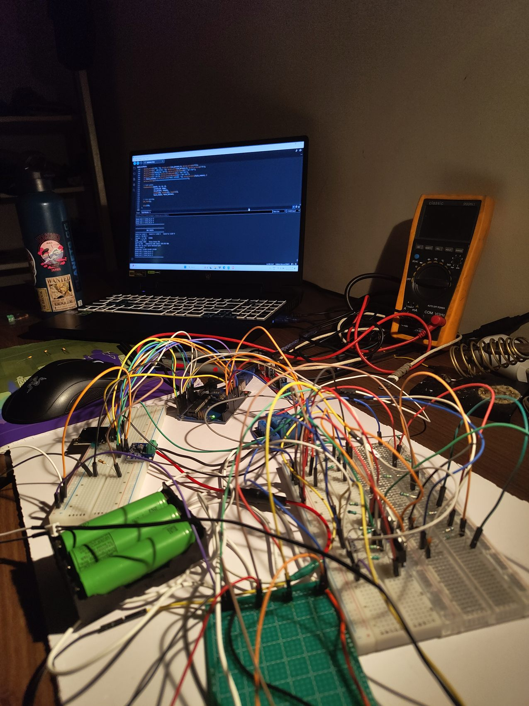

# Hardware and Wiring Notes

This document lists the **pin assignments and assumptions appearing in the supplied firmware**. It does not certify that the build photographs or hand-drawn circuit match the compiled code exactly.

## Pin assignments in `finalsubbms.ino`

| MCU pin | Firmware role | Notes |
| --- | --- | --- |
| `A0` | Tap voltage 1 | ADC reading converted using common configured divider ratio |
| `A1` | Tap voltage 2 | Calculated cell 2 voltage = tap 2 − tap 1 |
| `A2` | Tap voltage 3 | Calculated cell 3 voltage = tap 3 − tap 2; tap 3 treated as pack voltage |
| `A3` | NTC analog input | Conversion assumes a 10 kΩ series network and 3.3 V NTC supply |
| `D4` | Cell 1 passive-balancing control | Logic HIGH requests balancing; an external current-limited bleed circuit is needed |
| `D5` | Cell 2 passive-balancing control | Same control convention |
| `D6` | Cell 3 passive-balancing control | Same control convention |
| `D7` | Relay command | Configured **active-low** |
| Board I²C (`SDA` / `SCL`) | Optional INA219 | Actual pins depend on the specific Arduino-compatible board |

## Firmware electrical constants

- ADC reference assumed in code: `5.0 V` (`ADC_REF`). This is **not** automatically guaranteed by all boards or their supply conditions.
- ADC range assumed: `0`–`1023` (10-bit ADC).
- Nominal divider scaling: `100 / (330 + 100)`; the hand-drawn diagram appears to label a 330 kΩ / 100 kΩ branch, but **confirm resistor values and physical connections**.
- NTC network uses `V_TOP_NTC = 3.3 V`, `R_SERIES = 10,000 Ω`, `BETA = 3950 K`, and a 10 kΩ nominal NTC at 25 °C. Wiring orientation affects the correct resistance formula.
- INA219 uses `setCalibration_32V_2A()` if initialization succeeds.

## Images from the submitted project

## Before hardware testing or reproducing

- Reconcile the physical wiring and hand-drawn schematic with each code pin, including cell-tap ordering and shared grounds.
- Verify every analog pin remains within the MCU's rated input voltage under normal and fault conditions.
- Check the **voltage-divider resistor values, 3.3 V thermistor supply, real ADC reference**, and the actual relay input polarity.
- Confirm the external balancing path uses correctly sized resistors/switches and that the pins do **not** directly carry bleed current.
- Confirm the fuse, relay/contact rating, wiring gauge, charger/load ratings, cell chemistry, and independent pack protection.
- Verify operation first with an appropriate isolated, current-limited **battery simulator**, rather than assuming the photographed prototype is safe to power.

> An MCU and mechanical relay should not be treated as the only protective layers for lithium-ion energy storage. The provided design is for educational review, not deployment guidance.
